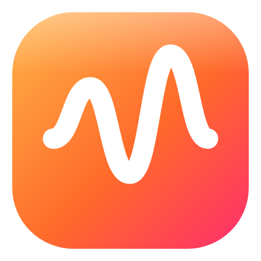

<p align="center"></p>

<h1 align="center">Tone Zone</h1>
<p align="center">A realtime guitar &amp; bass pedalboard for Linux (PipeWire). Pedals, amps, preamps, cabs, NAM models and IRs on a drag-and-drop board.</p>

---

## Install (Nobara / Fedora / any modern x86-64 distro)

1. Download `Tone-Zone-<version>-x86_64.AppImage` from the [latest release](https://github.com/goglesquirmintontheiii/tone-zone/releases/latest).
2. `chmod +x Tone-Zone-*.AppImage` and run it (or double-click it).

You need PipeWire with its JACK library (installed by default on Nobara; otherwise run
`sudo dnf install pipewire-jack-audio-connection-kit-libs`). The AppImage uses the static runtime, so you don't need
the `fuse2` package.

## Highlights

- **Board editor**: drag blocks in from the browser, move them around and patch them by dragging between the
  1/4" jacks. Cables sag like real ones and can be recoloured (right-click). An input takes one cable; drag a
  plugged input to move or unplug it, or Shift-drag an output to pick up its cable.
- **1598 built-in blocks**: 921 pedals and 43 multi-FX units inspired by real gear, 114 guitar &amp; bass amps,
  170 preamps, 73 cabinets with up to four draggable mics each, 247 Tone Zone originals and 6 pedalboards. That covers wahs,
  volume and whammy pedals, loopers, synths, acoustic preamps, DIs, splitters, mergers and other utilities. Pedals
  that can be stereo come in **mono and stereo versions**.
- **Real pedal layouts, as plugins**: blocks inspired by the units you know (BOSS, Ibanez, MXR, Dunlop, EHX, JHS,
  EarthQuaker, Walrus, Strymon, Meris, Chase Bliss, TC Electronic, Fender, Marshall, Mesa/Boogie and over 100 more
  brands) with the same knobs, switches, footswitches and screens in the same places, and similar colours. Each
  brand is one of 125 built-in **plugins** you can turn off. To write your own, see [docs/plugins.md](docs/plugins.md).
- **Plugins tab**: a card for each plugin with its details and blocks. Open any block in a small sandbox to try it
  without touching your board.
- **Line 6 Helix**: connect a Helix over USB and control it from the board (presets, snapshots, footswitches,
  expression, external switches, USB audio). You can also map its footswitches and expression pedal to the
  footswitches and treadles of other pedals on the board.
- **Low latency**: a native C++ engine that runs as a PipeWire (JACK API) client. The board adds no latency
  (except pitch blocks), so the round trip is whatever your PipeWire quantum gives you (64 frames at 48 kHz is
  about 2.7 ms).
- **DSP budget**: set how much of each audio cycle Tone Zone may use and see what each block costs. It can refuse
  blocks that would go over, or lower the quality for you (oversampling, IR length, A2 NAM size).
- **Works with PipeWire patchbays**: Tone Zone shows up as *Tone Zone* in Helvum, qpwgraph, Carla and so on, with
  2 guitar inputs, 2 returns, a stereo main out and 2 sends. There is also a routing panel built in.
- **NAM and IRs**: plays Neural Amp Modeler A1 and A2 (Full / Lite) models, LSTM and more, using
  NeuralAmpModelerCore 0.6. Import single files, many at once, folders or `.zip` packs. Several models become
  **one block with a model picker**, shown as an amp, pedal, preamp or cab. IRs (mono or stereo WAV, any sample
  rate) work the same way.
- **Capture tab**: turn a preset (or part of its chain) into your own NAM model. Tone Zone plays the training
  signal through it, trains the model, checks the accuracy and adds it to your Library. The first time, it installs
  the free NAM trainer and PyTorch in a private folder (needs Python 3 and an internet connection once).
- **Natural pitch shifting**: a WSOLA shifter for drop tuning, octaves, whammy and harmonies, with 10 to 21 ms
  latency options and no warble on chords.
- **Accurate tuners**: under a cent of error, down to low B on 5 and 6-string bass and F# on 8-string guitar. The
  PolyTune-style tuner also has a strum mode that shows every string at once.
- **Presets**: a Presets tab with board thumbnails, tags and favourites, about 180 factory presets (rhythm and lead
  rigs for many genres, artist and song tones, synth and meme rigs), undo / redo, import and export.
- **Pedalboards**: six empty boards from Tiny (4 pedals) to XL Max (28). Pedals dropped on a board snap into
  place, and dragging the board moves its pedals. Name them, and pick the frame and velcro colours.
- **Rotate blocks** in 90 degree steps (R, or right-click). Cables follow the jacks.
- **Couplers**: tiny double male and double female 1/4" couplers. A male coupler turns to fit the jack you drop it
  on and joins two pedals with no cable.
- **Pedal Factory tab**: design your own pedal's look (enclosure, finish, artwork, knobs, switches, jacks). The
  sound side comes later.
- **App themes**: Dark, White or Monochrome. Pedal graphics stay the same.
- **Raspberry Pi tab**: a placeholder for now. This is where putting presets on a Pi-based pedal will live.

What's planned next (including Windows support) is in [docs/roadmap.md](docs/roadmap.md).

## Using it

| Action | How |
|---|---|
| Turn a knob | drag up/down (Shift = fine), mouse wheel, double-click = default |
| Press a footswitch / button | click (footswitches have hold actions where the real pedal does) |
| Wah / volume / whammy treadle | drag; click without dragging = toe switch |
| Cab microphone | drag the mic over the speaker (position / distance), click it to change the mic |
| Patch | drag from one jack to another (only matching jack types connect: 1/4", TRS, XLR, headphone, MIDI…) |
| Select several blocks | Shift- or Ctrl-drag on empty board |
| Pan / zoom | drag empty board or middle-drag / mouse wheel |
| Shortcuts | `Del` delete · `Ctrl+D` duplicate · `B` bypass · `F` fit · `Ctrl+Z`/`Ctrl+Shift+Z` undo/redo · `Ctrl+S` save |

Real pedals take their input on the right, so by default the board flows right to left. You can switch to left to
right in Settings → Board.

Your data (presets, NAM/IR library, settings) lives in `~/.local/share/tone-zone`.

## Building from source

```bash
./scripts/build-engine.sh          # C++ engine (x86-64-v2 + AVX2/FMA builds) -> engine/dist
cd app && npm ci
npm start                          # run in development
npx electron-builder --linux AppImage
```

Engine test mode: `engine/dist/tonezone-engine-v2 --offline graph.json in.wav out.wav`.

## Project layout

- `engine/`: realtime DSP engine (C++20). PipeWire/JACK host, graph compiler, block library (`src/blocks/*`),
  NAM, convolution, tuner, looper.
- `app/`: Electron UI. Board editor, SVG pedal graphics (`renderer/js/gfx`), core block catalog
  (`renderer/js/catalog`), pages (presets, library, capture, Pi, plugins, settings), the plugin host
  (`renderer/js/plugins.js`) and the built-in brand plugins (`app/plugins/*`).
- `docs/`: plugin guide, engine block reference, release notes.

See [THIRD_PARTY.md](THIRD_PARTY.md) for bundled components. Product names are trademarks of their owners and are
only used to say which hardware a layout follows. Tone Zone is not affiliated with them.
